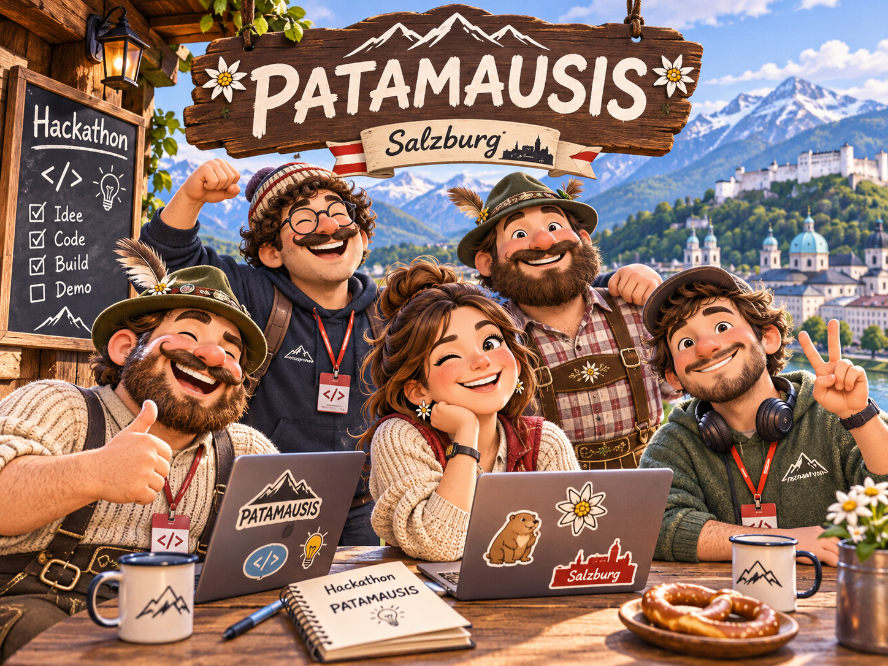

# 🏔️ Familienzeit
### Your family. Your holiday. Your time together.

A personalised holiday experience that helps families discover, plan and enjoy activities during their stay in **Serfaus-Fiss-Ladis**.

Familienzeit puts the family at the centre of holiday planning. By combining family preferences, destination information and activity discovery, we want to make it easier to create unforgettable experiences together.

Built during the **Tourism Technology Festival 2026** in Salzburg, Austria.

**Selected challenge:** Challenge 06 – One Family Holiday, Four Booking Systems.

---

## 💡 The Idea

Every family holiday is different.

Imagine arriving in Serfaus-Fiss-Ladis with two children, aged 4 and 9.

It's Tuesday, the weather forecast predicts rain, and you want to find something everyone can enjoy.

Where do you start?

Today, families have to navigate multiple platforms, compare age restrictions, check availability, consider weather conditions and switch between different booking processes.

**We want to change that.**

Familienzeit starts with the family, not with a catalogue of activities.

Our vision is to create a personalised holiday companion that understands what families enjoy and helps them make the most of their time together.

Families can define:
- Their holiday dates.
- Their destination.
- Their children's ages.
- Their interests and preferences.
- The experiences they are looking for.

Based on this information, Familienzeit aims to turn individual preferences into suitable activities and personalised holiday plans.

**Less searching. Less planning. More time together.**

---

## 🎨 The Prototype – Reise-Canvas

Our prototype explores a more personal and visual approach to holiday planning.

The **Reise-Canvas** is the starting point of the Familienzeit experience.

Instead of immediately presenting families with hundreds of activities, it allows them to create their own personalised holiday canvas — a visual representation of their family, destination and holiday preferences.

The prototype focuses on:
- A personalised family holiday experience.
- Defining the family and travel context.
- Selecting the destination.
- Capturing individual interests and preferences.
- Creating a personalised visual holiday postcard.
- An intuitive and engaging user experience.

### 🚀 Try the Prototype

**[Open Familienzeit – Reise-Canvas](https://familienzeit-canvas-prototyp.dervondenbergen.chatgpt.site/)**

---

## 🎯 The Challenge

**Challenge 06 – One Family Holiday, Four Booking Systems**

Challenge partner: Dialogschmiede GmbH, on behalf of Serfaus-Fiss-Ladis.

Serfaus-Fiss-Ladis offers a wide range of family activities, from kids' clubs and guided hikes to bike parks and cable car experiences.

However, information and booking processes are distributed across different systems:

| Platform | Purpose |
|---|---|
| Feratel | Events without registration |
| Feratel Experience Shop | Registration-based activities |
| Incert | Cable car experiences and online tickets |
| Contwise | Service providers and A–Z entries |

Families currently need to understand and navigate these systems individually.

Our goal is to make the experience feel like one connected destination.

---

## 🚀 Our Solution

We envision a unified family activity companion with three core capabilities.

### 1. Create – Your family's holiday canvas

Start with the people who matter most.

Families create their personal holiday profile by providing information about their travel dates, children's ages, interests and preferences.

This becomes the foundation for a personalised experience.

### 2. Discover – Find the right activities

Bring activities from different sources into one searchable experience.

Recommendations should consider:
- Children's age groups.
- Family interests and preferences.
- Travel dates and available time.
- Activity duration.
- Weather conditions.
- Opening hours and operational status.

### 3. Plan & Book – Make the most of every day

Turn individual activities into realistic daily plans.

The planner should consider:
- Available time and activity duration.
- Geographic distance between activities.
- Weather and changing conditions.
- Age suitability.
- Opening times and activity schedules.

Families can then continue to the relevant registration or booking process.

We distinguish between:
- Free activities without registration.
- Activities requiring registration.
- Paid experiences with online booking.

The goal is to reduce unnecessary steps without replacing the existing booking infrastructure.

---

## 👨‍👩‍👧‍👦 Our Target Audience

Familienzeit is designed specifically for families visiting Serfaus-Fiss-Ladis, especially parents who want to organise enjoyable activities for children of different ages.

Our example family:

- Two parents.
- Two children, aged 4 and 9.
- A week-long holiday.
- Different interests and activity preferences.
- A mixture of sunny and rainy days.

The experience should help the whole family find activities everyone can enjoy.

---

## 🧠 Intelligence & Personalisation

Our vision combines structured tourism data with intelligent recommendations.

Rather than relying on an AI model to invent activities or availability, we want to use actual destination data as the foundation for recommendations.

AI could help with:
- Understanding natural-language requests.
- Translating family preferences into search criteria.
- Explaining why activities match a family.
- Supporting itinerary creation.
- Suggesting alternatives when weather or availability changes.

Activity details, age restrictions, opening hours and booking information should remain grounded in their respective data sources.

---

## 🗂️ Data Sources & Integrations

The solution is designed around the data and infrastructure made available for Challenge 06.

| Source | Intended purpose |
|---|---|
| Feratel | Events and activities without registration |
| Feratel Experience Shop | Activities requiring registration |
| Incert | Cable car experiences and ticket booking |
| Feratel / Contwise | Service providers and destination information |
| Austrian Tourism Data | Events, POIs, tours, accommodation and gastronomy |
| GeoSphere Austria | Weather information |
| OpenStreetMap | Geographic information and distances |
| Open-Meteo | Weather forecasts |
| OpenHolidays API | School holiday information |

Additional contextual information:
- Family travel dates.
- Children's age groups: 0–2, 3–6, 7–12 and 13–17.
- Interests and preferences.
- Lift and trail status.
- Opening hours and operational information.

Integration status and data availability depend on the access provided by the respective partners.

---

## 🏗️ Technical Concept

The intended architecture separates the user experience, data integration, activity matching and itinerary planning.

### Main components

1. **Frontend:** Personalised family holiday canvas and activity discovery interface.
2. **Family profile:** Travel dates, children's ages, interests and preferences.
3. **Data integration:** Connect and normalise information from different tourism systems.
4. **Recommendation engine:** Match activities against family profiles and contextual conditions.
5. **Planning engine:** Build realistic daily itineraries based on time, distance and weather.
6. **Booking integration:** Connect users to appropriate registration and payment flows.
7. **AI layer:** Natural-language interaction and recommendation explanations.

### Technology

The current public repository does not yet contain the application source code or a verified implementation stack.

Technology choices and implementation details will be documented here as the codebase evolves.

Potential hackathon infrastructure includes:
- Next.js starter application.
- n8n workflows.
- one.intelligence AI models.
- Supabase and PostgreSQL.
- MCP integrations.
- TTF Data Space.

These are potential technologies and integrations, not a declaration of currently implemented components.

---

## 🎯 MVP – Our Goal

Our objective is to demonstrate a complete family holiday journey:

1. A family opens Familienzeit.
2. They create their personal holiday canvas.
3. They enter their holiday dates, children's ages and interests.
4. The application discovers suitable activities across different sources.
5. The family receives recommendations that account for weather and timing.
6. The application creates a practical daily itinerary.
7. The family can open the original activity details and continue to registration or booking.

**The key experience:** One family, one personalised experience, multiple booking systems — without having to search through them individually.

---

## 🌱 Our Vision

We believe destination experiences should be organised around the guest, not around the systems that store the information.

Familienzeit starts in Serfaus-Fiss-Ladis, but the vision goes beyond a single destination.

The same approach could eventually help tourism regions connect fragmented activity catalogues, booking systems and contextual information into one coherent guest experience.

A family should not need to understand the technology behind a destination to enjoy everything it has to offer.

**Less organising. More experiencing. More Familienzeit.**

---

## 👥 Our Team



| Name | Role |
|---|---|
| Felix | CSO (Chief Slop Operator) |
| Eva | TBD |
| Jakob | TBD |
| Niki | TBD |
| Lukas | TBD |

---

## 🛠️ Getting Started

Build the static sites with Node.js 24 and serve the output locally.

```sh
node scripts/build-pages.mjs
python3 -m http.server 8000 --directory dist/pages
```

Open [the local planner](http://localhost:8000/). The build includes both prototypes. For the GitHub Pages edition, edit the public activity catalogue in [familienzeit/static/catalog.json](familienzeit/static/catalog.json). Put local photos under `familienzeit/static/photos/` and reference them as `./photos/filename` in the catalogue.

The [GitHub Pages workflow](.github/workflows/pages.yml) publishes the static build from `main`. Catalogue changes made in the ChatGPT Sites admin panel need to be copied into the static catalogue before publishing.

---

## 📸 Screenshots & Demo

### Familienzeit – Reise-Canvas

Explore the current prototype:

**[Open the live prototype →](https://familienzeit-canvas-prototyp.dervondenbergen.chatgpt.site/)**

Screenshots and recordings will be added to the repository as they become available.

---

## 🏆 Hackathon

**Tourism Technology Festival 2026**

- 📍 Messezentrum Salzburg, Austria
- 📅 7–8 November 2026
- ⏱️ 24-hour hackathon

**Selected challenge:** Challenge 06 – One Family Holiday, Four Booking Systems.

**Challenge partner:** Dialogschmiede GmbH / Serfaus-Fiss-Ladis.

### Useful Resources

- [Tourism Technology Festival](https://www.tourism-technology.com/)
- [TTF 2026 – Challenges & Resources](https://buildbar.at/ttf-2026)
- [Serfaus-Fiss-Ladis](https://www.serfaus-fiss-ladis.at/)
- [Live Familienzeit Prototype](https://familienzeit-canvas-prototyp.dervondenbergen.chatgpt.site/)
- [GitHub Repository](https://github.com/Dreiforce/tourism-technology-festival-2026)

---

*Familienzeit – Weniger planen. Mehr gemeinsam erleben.* 🏔️